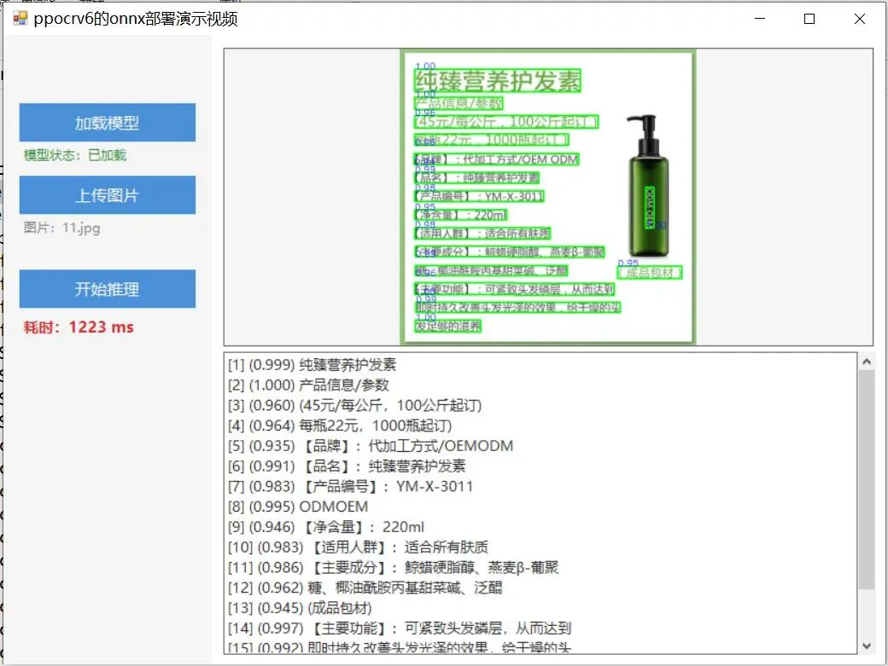

# Deploy PPOCRv6 ONNX model openvino edition based on C# Winform

# Deploying ONNX model from PPOCRv6 on C# Winforms with OpenVINO

## PaddleOCRv6ONNX Deployment Demo

The desktop OCR text recognition demonstration program based on **OpenVINO + PaddleOCR v6** is implemented using C# Windows Forms to enable online model download, image upload, OCR inference, detection box visualization, and time-consuming statistics.

---



Insert image description here.

### I. Algorithm Principles

1.1 PaddleOCR v6 overall architecture

PaddleOCR v6 adopts a **three-stage serial** OCR pipeline design:

```
Input image
   ↓
┌─────────────────────────┐
Text detection (DB/DB++) ← Locating text areas, outputting rotated rectangles
└────────────┬────────────┘
             ↓
┌─────────────────────────┐
Direction classification (lightweight classifier) ← Determine whether the text is rotated by 180° and flip it as needed
└────────────┬────────────┘
             ↓
┌─────────────────────────┐
Text recognition (CRNN/SVTR) ← Identify the text content and confidence for each detection box.
└────────────┬────────────┘
             ↓
Output: Text content + Confidence level + Detection box coordinates
```

1.2 Detailed Explanation of Each Stage

|

Stage

 ||

Algorithm

 ||

Function

 |

| **Text Detection** ||

DB (Differentiable Binarization)

 ||

Based on the differential binary segmentation network, outputs the rotated rectangle of text regions (RotatedRect)

|
| **Direction Categories** ||

Lightweight MobileNet classifier

 ||

Discriminate between 0°/180° directions for detected text blocks, solving the problem of inverted text recognition.

|
| **Text Recognition** ||

CRNN + CTC / SVTR

 ||

Perform sequence recognition on normalized text image blocks, outputting the text string and confidence score

 |

1.3 OpenVINO inference backend

This project uses Intel **OpenVINO** as the inference engine, replacing the native inference of PaddlePaddle with the following advantages:

-

• Deeply optimized Intel CPU / GPU / NPU

-

• Called by C# layer through `openvino_c.dll` (C API)

-

• The model format is ONNX, and it is directly loaded through the ONNX Frontend of OpenVINO.

1.4 Principle of Visualization of Detection Boxes

Each recognition area corresponds to a `RotatedRect` (rotated rectangle), which contains the center point, width and height, as well as the rotation angle. When drawing:

1.

1. Call `Cv2.BoxPoints(rect)` to calculate the **4 vertices coordinates** of the rotated rectangle (`Point2f[]`).

1.

2. Draw a green quadrilateral outline on the image using `Cv2.Polylines`

1.

3. Use `Cv2.PutText` to label the top-left corner of the box with **blue confidence score**

---

### 2. Environmental Requirements

|

Project

 ||

Requirements

 |

| **Operating System** ||

Windows 10 / 11 (x64)

 |
| **IDE** ||

Visual Studio 2019 or above

|
| **.NET Framework** ||

.NET Framework 4.7.2

|
| **C# Syntax Version** ||

C# 6.0 (Do not use C# 6.0 syntax features above)

|
| **Compilation Platform** ||

x64 (must select x64 platform, does not support AnyCPU / x86)

VC++ Runtime | Microsoft Visual C++ 2015-2022 Redistributable (x64) |
Network |

The first run requires a network connection to download the model (approximately 100 MB).

 |

#### Main Dependency Library Version

|

Repository name

 ||

Version

 ||

Note

 |

| `Sdcb.OpenVINO` ||

0.7.1

 ||

OpenVINO C# encapsulation

 |
| `Sdcb.OpenVINO.PaddleOCR` ||

0.8.0

 ||

PaddleOCR inference encapsulation

 |
| `Sdcb.OpenVINO.PaddleOCR.Models.Online` ||

0.8.0

 ||

Online model download

 |
| `Sdcb.OpenVINO.runtime.win-x64` ||

2026.2.0

 ||

OpenVINO Windows x64 native runtime

 |
| `OpenCvSharp4` ||

4.11.0

 ||

Image processing library

 |
| `OpenCvSharp4.Extensions` ||

4.11.0

 ||

Mat ↔ Bitmap Conversion Extension

 |

---

### III. Installation Steps

#### 3.1 Install Visual Studio 2019

1.

1. Download and install Visual Studio 2019

1.

2. Check the ".NET Desktop Development" option under workloads.

1.

3. Ensure the installation of **.NET Framework 4.7.2 Targeting Pack**

#### 3.2 Install VC++ Redistributable

>

**Must be installed**, otherwise the native DLL (`openvino_c.dll`) of OpenVINO cannot be loaded and will throw a `TypeInitializationException`.

#### 3.3 Cloning or Downloading Projects

```
git clone firc-projects
# or directly download and unzip.
```

3.4 Restore NuGet packages

After opening the solution in Visual Studio, right-click on the solution → **Restore NuGet packages**, or through the command line:

```
nuget restore FIRC.sln
```

---

### 4. Operating Steps

4.1 Compilation Project

1.

1. Open `FIRC.sln`

1.

2. Switch the platform in the toolbar to **x64** (do not select AnyCPU).

1.

3. Configuration selection - **Debug**

1.

4. Generate the project by pressing `Ctrl+Shift+B`

4.2 Launching the Program

Press F5 to run, and the interface will be as follows:

```
┌─────────────────────────────────────────────────┐
The ppocrv6 onnx deployment demonstration video.
├───────────────┬─────────────────────────────────┤
│  [Load model]    │                                 │
Model status: ... │   (Image preview area)
[Upload image] │                                 │
Image: ... ├─────────────────────────────────┤
│  [Start reasoning]    │                                 │
| Duration: -- ms | (Recognition result text area) |
│               │                                 │
└───────────────┴─────────────────────────────────┘
```

4.3 Operational Procedures

|

Steps

 ||

Operation

 ||

Note

 |

|

1

 ||

Click **"Load Model"**

 ||

Automatically download the ChineseV6Tiny model (requires internet connection for the first time, subsequent use uses cache)

 |
|

2

 ||

Click **"Upload Image"**

 ||

Select JPG / PNG / BMP / TIFF format images.

 |
|

3

 ||

Click **"Start Reasoning"**

 ||

Perform OCR recognition, draw a green detection box on the image, and display the text and confidence level in the result box.

 |

4.4 Identification Result Format

The result text box format is as follows:

```
[1] (0.987) The text content identified
[2] (0.952) Paragraph 2
...
```

Among them:

-

• [Number] — Detection area number

-

• `(Confidence)` — Recognition confidence, range 0~1

-

• The text identified in the subsequent area

---

### 5. Notes

5.1 The platform must select x64

OpenVINO native runtime only provides x64 version, choosing AnyCPU or x86 will cause `DllNotFoundException` or `TypeInitializationException`.

5.2 Missing VC++ Redistributable Issue

If a "Native DLL Loading Failed" window pops up when starting, it means that the VC++ runtime is not installed. Please install it and restart your computer.

5.3 First Model Download

-

• The first click "Load Model" will automatically download the PaddleOCR ChineseV6Tiny model (about 100 MB) from the network.

-

• After downloading, it will be cached locally, and subsequent startups do not require re-downloading.

-

• If the network is unstable, you can configure a proxy or manually download and then put it in the cache directory.

5.4 C# Syntax Restrictions

This project strictly uses the syntax of **C# 6.0**, and the following features are **not available**:

-

• `$""` String interpolation (available in C# 6.0, but has been uniformly replaced with `string.Format` within the project)

-

• `?.` Null conditional operator (available in C# 6.0, but note)

-

• `??=` Null merge assignment (C# 8.0)

-

• Nullable reference type `string?` (C# 8.0)

-

• `switch` expression (C# 8.0)

-

• `record` type (C# 9.0)

#### 5.5 System.Drawing and OpenCvSharp naming conflicts

Both libraries define types such as `Point`, `Size`, `Rectangle` etc., and usage requires full namespace qualifiers:

```
// Correct
OpenCvSharp.Point pt = new OpenCvSharp.Point(10, 20);
System.Drawing.Point pt2 = new System.Drawing.Point(10, 20);
// Error (Compilation error CS0104: Ambiguous reference)
Point pt = new Point(10, 20); // Unclear which one
```

5.6 Image Format Support

Supported image formats: `.jpg`, `.jpeg`, `.png`, `.bmp`, `.tiff`, `.tif`

---

### VI. Folder Structure

```
FIRC/
├── FIRC.sln                        # Visual Studio Solution file
├── FIRC.csproj  # Project file (Target Framework, References, Compile Configuration)
├── packages.config  # NuGet package version list
├── App.config  # Application configuration file
│
├── Program.cs  # Program entry point: preload openvino_c.dll, Start Window
├── Form1.cs  # Main form logic: Model loading, image upload, OCR inference, result visualization
├── Form1.Designer.cs  # Form UI designer code (control layout and style definition)
├── Form1.resx  # Form1 resource file for the form
│
├── Properties/                 # Project properties
├── AssemblyInfo.cs # Program Metadata (version, company name, etc.)
├── Resources.resx # Embedded resource definition
├── Resources.Designer.cs # Resource Access Code (automatically generated)
├── Settings.settings # Defines application settings
└── Settings.Designer.cs # Setting access code (auto-generated)
│
├── packages/ # NuGet package local cache
│ ├── Sdcb.OpenVINO.0.7.1/  # OpenVINO C# Wrapper
├── Sdcb.OpenVINO.PaddleOCR.0.8.0/  # PaddleOCR inference encapsulation
│ ├── Sdcb.OpenVINO.PaddleOCR.Models.Online.0.8.0/ # Online Model Download
├── Sdcb.OpenVINO.runtime.win-x64.2026.2.0/ # OpenVINO Windows x64 native runtime
├── OpenCvSharp4.4.11.0.20250507/ # OpenCvSharp image processing library
├── OpenCvSharp4.Extensions.4.11.0.20250507/ # Mat↔Bitmap conversion extension
└── ... # Other system dependency packages
│
└── bin/
    └── x64/
└── Debug/ # x64 Debug compilation output directory
├── FIRC.exe # The main program executable file
├── FIRC.exe.config # Run-time configuration
├── FIRC.pdb # Debugging symbol file
            ├── Sdcb.OpenVINO.dll   # OpenVINO Managed assembly
├── Sdcb.OpenVINO.PaddleOCR.dll # PaddleOCR inference managed assembly
├── OpenCvSharp.dll # OpenCvSharp managed assembly
├── openvino_c.dll  # OpenVINO C native interface DLL
├── openvino.dll # OpenVINO core native DLL
├── tbb12.dll # Intel TBB multithreading library
            └── dll/
├── win-x64/ # OpenVINO native DLL (runtime copy)
                │   ├── openvino.dll
                │   ├── openvino_c.dll
                │   ├── openvino_intel_cpu_plugin.dll
                │   ├── openvino_intel_gpu_plugin.dll
                │   ├── tbb12.dll
                │   └── ...
                ├── x64/            # OpenCvSharp x64 Native DLL
                │   └── OpenCvSharpExtern.dll
└── x86/ └── OpenCvSharp x86 native DLL (not used in this project)
                    └── OpenCvSharpExtern.dll
```


## Payment

Here is a pay link on Stripe ( https://buy.stripe.com/3cs8yP7sY87d0vu9AB ). Please contact me lonlonago@foxmail.com after funding $89, and I will send you a complete data files , thank you!


